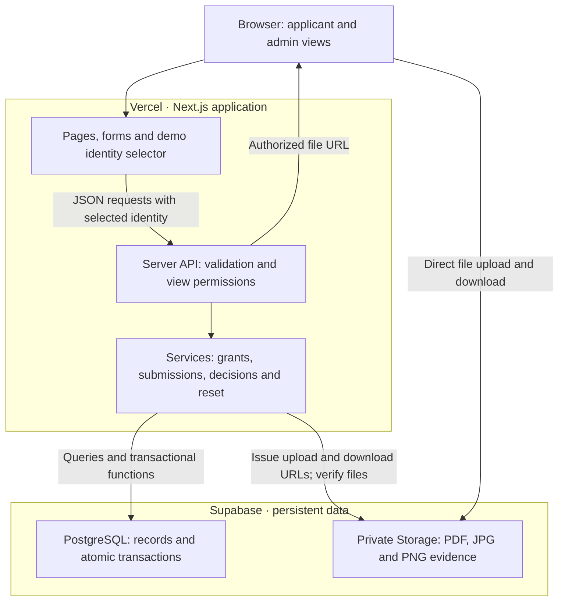

# Grant Application and Award Demo — Technical Design

> Published design proposal. See [Implementation notes](implementation.md) for the deployed Edge Function boundary, current verification, and implementation limits.
Version 1.0 · October 29, 2026 · Proposed implementation

Source: [grants-demo-prd.md](https://chatgpt.com/library?file_id=libfile_0210fa35a82c8191876fe7762efe9b2b&account_id=personal), PRD v0.3, Library version 2. This document translates the PRD into an implementation plan; it does not claim that the system has been built or tested.

## 1. Design summary

Build one Next.js / TypeScript application hosted on Vercel. Use Supabase PostgreSQL for durable records and a private Supabase Storage bucket for uploaded evidence. Keep business rules in a small server-side service layer, with transactional database functions for submissions, decisions, budget edits, and reset.

This keeps the demo small while preserving its most important behavior: the applicant and admin see the same records, approval cannot overspend a grant, and refreshes or identity switches do not lose data. No payment service, authentication provider, background queue, or workflow engine is needed.

The persistent banner reads “Demo mode — no authentication. Use sample data only.” Selecting a demo user changes the acting identity; it is not proof of identity. Application-level permission checks illustrate the PRD, but do not make this safe for real applicant information.

## 2. Architecture diagram



**Read the diagram:** the server controls data operations and issues file access URLs; the browser transfers file bytes directly to Storage. PostgreSQL stores file references, not document bytes. Direct uploads accommodate the PRD’s 10 MB files without passing them through Vercel Functions’ documented 4.5 MB request limit [1]. Supabase provides signed upload URLs and private-file signed downloads [2, 3].

## 3. Engineering choices and unresolved product details

These are implementation defaults, not additional PRD requirements.

| Topic | Proposed choice |
| --- | --- |
| Demo data scope | One shared dataset per environment. All visitors see mutations when they fetch again; Reset demo affects that environment. Separate visitor sandboxes can be added later if required. |
| Currency | USD only; integer cents in database and API. Accept at most two decimal places; reject excess precision rather than silently rounding requests. |
| Distribution rounding | Round 25% of a positive award to nearest cent, half up: `(award_cents + 2) / 4` using integer division. An award of $0.01 can yield a $0.00 distribution record. |
| File limit | Interpret 10 MB as 10,000,000 bytes; at least one completed file per required document description. Allow multiple files per requirement. |
| Grant edits | Keep a requirements revision on the grant. Snapshot descriptions and requirements on submission so subsequent edits do not reinterpret submitted evidence. No document version-history UI. |
| Form becomes stale | If the grant changes before submission, return a conflict and ask the applicant to review current requirements. Preserve in-memory input while reconciling. |
| Manual checklist | Local review aid, initialized from the submitted requirements snapshot. It does not save a review state or gate decisions; only a final decision changes application status. |
| Applicant drafts | Text lives only in browser memory until submission. Temporary file uploads are staging records, not saved application drafts. Refresh may discard an unfinished form. |
| Closed grant edits | Creator may edit descriptive fields, budget and reviewer; status cannot reopen. Existing submissions remain reviewable. |
| Zero budget | Allowed by the PRD’s negative-budget prohibition. Open grants with no available funding display “Fully allocated” and block new submissions. |

## 4. Data model

All IDs are UUIDs. Store timestamps in UTC and format them consistently in the UI. Every mutable demo record is associated with the current environment’s dataset generation so stale operations after a reset can be rejected.

| Table | Essential fields and constraints |
| --- | --- |
| `demo_users` | `id`, `display_name`, `email`, `role` (`admin` or `applicant`); seed at least two of each. |
| `demo_state` | Singleton `id`, `generation`, `seed_version`; coordinates mutations and reset. |
| `grants` | `id`, `creator_id`, `reviewer_id`, `title`, `description`, `eligibility`, ordered `document_requirements` JSON, `requirements_revision`, `budget_cents >= 0`, `status`, `created_at`, `updated_at`. Creator and reviewer must be admins. Requirement entries have stable IDs. |
| `applications` | `id`, `grant_id`, `applicant_id`, submitted `name` and `email`, `requested_cents > 0`, `requirements_snapshot`, `status`, `submitted_at`, `decided_by`, `decided_at`, optional `internal_note`. Unique `(grant_id, applicant_id)`. Decision fields absent while Unreviewed and present after decision. |
| `upload_intents` | `id`, `generation`, `grant_id`, `applicant_id`, `requirement_id`, `requirements_revision`, unique `object_key`, declared and verified type/size, `status`, `expires_at`, optional `consumed_at`. Server creates keys. |
| `documents` | `id`, `application_id`, `requirement_id`, `upload_intent_id`, unique `object_key`, original filename, verified type, verified byte count. Each upload intent can be consumed once. |
| `awards` | `id`, unique `application_id`, `amount_cents > 0`, `created_at`. One award for each Approved application only. |
| `simulated_distributions` | `id`, unique `award_id`, `amount_cents >= 0`, `created_at`. Exactly one initial distribution per award. No payment status or bank fields. |

Use foreign keys throughout. Index applications by grant/status and applicant/submission date, grants by creator and reviewer, and staging uploads by expiration. Cross-table rules such as award ≤ request and budget ≥ commitments belong in transactional database functions; deny browser access and avoid generic write endpoints that bypass them.

Financial summaries are derived from awards and distributions. Aggregate each separately before joining to grants so multiple documents or other joined records cannot multiply totals.

| Metric | Calculation |
| --- | --- |
| Committed | Sum of award cents for the grant |
| Available | Budget minus committed |
| Simulated distributed | Sum of distribution cents for the grant |
| Committed but undistributed | Committed minus simulated distributed |
| Applicant remaining award | Their award minus their distribution |
| Applicant count | Count of submitted applications across all three statuses |
| Unreviewed count | Count where application status is Unreviewed |

## 5. Permissions and response shapes

Every request supplies a selected demo-user ID. Resolve its role on the server rather than accepting a role from the browser. Run permission checks on reads, mutations, and file access. This models product behavior but remains impersonable because the selector intentionally allows switching users.

| Action | Applicant | Any admin | Creator or assigned reviewer | Creator only |
| --- | --- | --- | --- | --- |
| Browse open grant details | Yes; no aggregate finances | Yes | Yes | Yes |
| Browse admin grant summaries, including drafts | No | Yes | Yes | Yes |
| Read an application and its documents | Own only | No | Yes, within that grant | Yes |
| Submit an application | Own identity only | No | No | No |
| Approve or reject | No | No | Yes | Yes |
| Edit, publish, close, change budget or reviewer | No | No | No, unless creator | Yes |

Applicants can also read a closed grant attached to their application. For applicant responses, explicitly select permitted fields: omit grant budget, committed totals, aggregate distributions, internal notes, and other applicants. Return an `accepts_applications` flag and a closure/fully-allocated reason without exposing budget values. Clear identity-specific cached data immediately on identity switch and refetch using cache keys containing identity and dataset generation. Ignore late responses from the previous identity.

## 6. API outline

Use Next.js route handlers calling shared service functions. Return structured errors `{code, message, fieldErrors?}`. Successful writes return the canonical record and refreshed relevant totals.

| Endpoint | Contract |
| --- | --- |
| `GET /api/demo-users` | Available named identities and roles. |
| `GET /api/grants` | Applicant: open catalog with title search. Admin: all/created/assigned filter, distinct grant counts and financial summaries. |
| `POST /api/grants` | Creator saves Draft or publishes Open with validated required fields. Prefill is client configuration; opening the form writes nothing. |
| `GET /api/grants/:id` | Role-specific detail. |
| `PATCH /api/grants/:id` | Creator edits fields, budget or reviewer; expected revision prevents lost updates. |
| `POST /api/grants/:id/publish` or `/close` | Enforce Draft → Open → Closed transitions. |
| `POST /api/uploads` | Validate declared file metadata and return upload intent plus signed upload URL. |
| `POST /api/uploads/:id/complete` | Verify object exists, byte count and allowed content signature; mark ready or return actionable error. |
| `POST /api/grants/:id/applications` | Submit fields, revision and ready upload-intent IDs; create complete application atomically. |
| `GET /api/applications` | Applicant’s own records, or permitted admin review queue with status filter. |
| `GET /api/applications/:id` | Role-specific application detail and document metadata. |
| `POST /api/applications/:id/decision` | `approve` with award cents or `reject`; optional internal note. Final, transactional operation. |
| `GET /api/documents/:id/download` | Check ownership/review permission, issue short-lived URL, return filename. |
| `POST /api/demo/reset` | Admin-mode action after UI confirmation; expected dataset generation required. Restore baseline atomically. |

Use 400/422 for invalid input, 403 for denied operations, 404 for unavailable records, 409 for stale state/duplicate/conflicting decisions, and a retryable error for transient storage/database failures. Use exact PRD empty-state messages in the UI; do not substitute technical errors for empty states.

## 7. Submission and upload flow

1. Applicant opens an Open grant. The form captures its requirements revision. Disable Apply when available funding is zero; requested funding itself never reserves budget.
2. Server issues a distinct staging object key per file and signed upload URL. Browser uploads directly to the private bucket. Disable overwrite for existing objects.
3. Completion verifies actual object presence, size and PDF/JPEG/PNG signature. Do not trust filename extensions or browser-provided MIME alone. Failed uploads remain incomplete with a retry action.
4. On Submit, acquire a shared dataset-state lock and then lock the grant row. Recheck generation, Open state, positive available funding and unchanged requirements revision. Validate required fields, positive requested amount, and complete coverage of all requirements. A request may exceed available funding; an eventual award may not.
5. Verify ready uploads belong to this applicant, grant and revision and are not expired or already consumed. Atomically insert one Unreviewed application, linked documents and consume the uploads. Commit only when all checks pass.
6. Return confirmation and View application. A repeated request finds the unique existing application and returns it without changing its data; conflicting payloads receive a duplicate-submission conflict.

Storage and PostgreSQL do not share a transaction. Upload and verify files first; only commit document links when complete. Keep the same object keys after submission to avoid a fragile post-commit move. Expired, unconsumed objects can be cleaned by a maintenance script or reset cleanup. Cleanup must lock/claim eligible intents so it cannot delete a file being attached to a submission. No applicant draft-saving feature is introduced.

## 8. Approval transaction and concurrency

All operations changing a grant’s funding or lifecycle must lock the same grant row. This serializes approvals with other approvals, budget edits, closing, submission checks and reviewer reassignment. Use a consistent lock order: dataset state → grant → application → upload intents, where applicable.

```mermaid
sequenceDiagram
    participant A as Admin UI
    participant S as Server
    participant D as PostgreSQL
    A->>S: Confirm approval and award amount
    S->>D: Begin; lock dataset, grant and application
    D->>D: Recheck actor, status, request and available budget
    alt Valid Unreviewed application
        D->>D: Insert award and 25% distribution; mark Approved
        D-->>S: Commit decision and totals
        S-->>A: Show confirmed award and distribution
    else Conflict or insufficient budget
        D-->>S: Roll back; return current state
        S-->>A: Show error and refresh confirmation values
    end
```

For approval, validate award > 0, award ≤ request, and award ≤ current budget minus committed awards. Create the award, distribution and decision metadata in one transaction. Rejection records the actor/time/note and changes status without creating financial records. Opening a page or changing reviewer assignment never changes application status.

A retry matching an existing final decision returns that decision. An attempt to alter a final decision returns 409. Unique constraints on awards and distributions provide a second defense against duplicates. If a response is lost, the client refetches status before offering a retry. Never show success before commit.

Budget edits take the grant lock and reject a new value below committed awards. Derive available funds from awards, never subtract distributions again. For a $100,000 budget and $20,000 award, return $80,000 available, $5,000 simulated distributed and $15,000 committed but undistributed.

## 9. Persistence, seeds and reset

Use synthetic fixtures: two admins, two applicants, Draft/Open/Closed grants, a grant assigned to the second admin, and Unreviewed/Approved/Rejected submissions with valid sample evidence. Seed approved examples using the same financial formulas as live decisions. New grants always start with no application or financial records.

Reset requires the PRD confirmation dialog. All mutations hold a shared lock on `demo_state`; reset takes an exclusive lock, increments its generation, replaces database fixtures and commits. Old forms and in-flight upload completions fail generation checks. Use generation-prefixed object keys so cleanup of the prior generation cannot delete new files. Keep baseline sample files immutable and restore their database references. Storage cleanup happens after the database reset and can be retried independently; do not report a reset failure solely because obsolete file cleanup is delayed.

Refresh and mode switching reload persisted records. Do not use localStorage as the system of record. Revalidate affected lists, details, counts and balances after mutations. For this demo, refetch on focus/navigation; live cross-browser updates are not a requirement. The next mutation always rechecks current database state.

## 10. Deployment and operational boundaries

1. Create separate Supabase environments for development/preview and the shared published demo. Configure a private evidence bucket with allowed types and the chosen maximum size.
2. Apply version-controlled SQL migrations, including schema, constraints, indexes and transactional functions; run synthetic seeds once. Never reseed automatically on every deploy.
3. Deploy the Next.js repository to Vercel. Configure the Supabase URL and server-only secret in environment variables; never put the secret in browser bundles, public-prefixed variables, source control or logs. Server calls database functions via Supabase RPC and queries through its server client.
4. Deny direct anonymous table access and restrict execution of write functions to the server credential. Any elevated database functions need explicit execution permissions and fixed search paths. Keep business checks inside the transactional boundary.
5. Log request IDs, operation outcomes and diagnostic codes; omit document contents, signed URLs, submitted emails and internal notes. Provide clear retry states when services are unavailable.
6. Smoke-test the published flow with synthetic data, then confirm reset returns the exact baseline.

The demo uses no real payments or authentication. A private bucket and server-side filtering reduce accidental exposure, but a visitor can select another identity. Production would require a separate design for verified identity, authorization, retention, document scanning, auditability and government policy. These are not delivery requirements for this demo. Provider pricing and plan quotas should be checked when provisioning; no hosting-cost or performance guarantee is assumed here.

## 11. Verification plan mapped to the PRD

| PRD acceptance criteria | Required check |
| --- | --- |
| 1, 13 | Opening prefilled creation writes nothing; Save draft persists admin-only data; Publish exposes an empty grant to applicants. |
| 2, 3 | Valid submission creates one record; repeated clicks create no duplicate; missing, invalid, oversized or failed files cannot produce a complete application. |
| 4, 5, 11 | All Grants defaults correctly; creator/reviewer filters and permissions match; opening an application leaves it Unreviewed. |
| 6, 7 | Approval creates exactly one award/distribution and matching views; rejection only changes decision/counts. |
| 8 | Concurrent awards of $70,000 and $50,000 against $100,000 cannot both succeed; concurrent budget reduction cannot violate commitments. |
| 9, 12 | Switching identities removes prior cached records; applicant payloads omit internal notes, budget and aggregate allocations. |
| 10 | Reload retains records and documents; reset restores fixtures; stale forms and upload completions cannot modify the reset dataset. |
| 14 | Exercise every PRD empty state and its action across list, search and status filters. |

Additional boundary checks: zero funding blocks new submissions but not review; Closed blocks submission but allows existing decisions; reassignment revokes the former reviewer’s application access; edits during application entry trigger a revision conflict; rounding handles $0.01, $0.02, $0.03 and $20,000 correctly; lost approval responses can be retried without duplicates. Use unit tests for money/state validation, database integration tests for concurrency and rollback, and browser tests for the primary end-to-end journey. These are planned checks, not completed test results.

## 12. Implementation order

1. Schema, seed fixtures, transaction functions and permission-aware response types.
2. Identity banner, grant creation/catalog/detail, ownership filters and lifecycle actions.
3. Direct uploads, verification, submission and applicant profile.
4. Review queue, manual checklist, decisions and derived financial summaries.
5. Reset, empty/error states, concurrency verification and Vercel smoke test.

## References

- Product authority: PRD v0.3 linked at the top; its government-attachment references are background, not independently validated here.
- [1] [Vercel Functions limits](https://vercel.com/docs/functions/limitations): documented 4.5 MB request/response payload limit.
- [2] [Supabase signed upload URLs](https://supabase.com/docs/reference/javascript/file-buckets-createsigneduploadurl).
- [3] [Supabase private file downloads](https://supabase.com/docs/guides/storage/serving/downloads).

Provider documentation consulted October 29, 2026. Stack selection and edge-case defaults above are engineering proposals; the PRD remains authoritative for demo scope.
