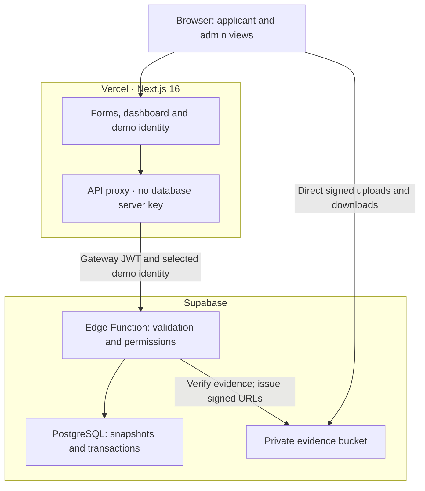

# Implementation notes

This document describes the implementation of the [PRD](grants-demo-prd.md). The [technical design](grants-demo-technical-design.md) preserves the initial proposal; the deployed server boundary below supersedes its direct Vercel-to-database configuration.

## Architecture

The Edge Function obtains its server key from Supabase's runtime environment. Vercel holds the function URL and a public legacy anon JWT for gateway verification. No server key is stored in the browser or repository. The gateway JWT identifies the calling application; it does not authenticate the selected demo person. All visitors can change identities, as required by the demo scope.

One shared handler supports both the hosted Edge Function and an optional direct local server mode. Request validation, role filtering and error handling are therefore consistent across those environments.

## Integrity decisions

- Dataset generation and lock ordering coordinate resets with all mutations. Stale forms and upload completions cannot mutate a new generation.
- Each funding mutation locks the grant. Concurrent awards and budget edits recheck committed funding within that transaction.
- Exactly one award and initial distribution can exist per approved application. Matching retries return the existing result; final decisions cannot be changed.
- USD values are integer cents. The distribution is 25% of the award, rounded half up. A one-cent award has a valid zero-cent initial distribution record.
- One SQL snapshot produces generation, grants and permitted application records together, avoiding inconsistent totals across separate queries.
- Applicant payloads omit aggregate funding, internal notes and other applicants. SQL table/RPC permissions deny direct public access; RLS remains enabled without public policies.
- Uploads are staged and verified before submission. Required evidence, ownership, expiry, revision and generation are checked again when attaching files atomically.
- Requirements are snapshotted at submission, so edits do not reinterpret previously submitted evidence.
- Domain conflicts use `PT409`, rather than PostgreSQL's retryable serialization-failure code. Reset uses an explicit predicate compatible with Supabase's REST safe-update protection.

## Verification

The implementation is checked with unit, TypeScript, production-build, API integration and browser tests. Exact completed results and deployment details are recorded here after release verification.

Supabase security inspection confirms that anonymous callers cannot read application tables or execute mutation RPCs, and the evidence bucket is private. The RLS-without-policy informational notices are intentional: the demo's server is the only permitted database caller. The missing foreign-key indexes identified during inspection were added.

## Deliberate limits

This is a functional demonstration, not a production government system. It uses sample identities, synthetic records and simulated distributions. Production identity, government operating policies, compliance controls and nonfunctional acceptance work still need customer discovery and design. Reset affects every visitor. Unreferenced uploaded objects are not automatically garbage-collected, and supported-signature verification is not malware scanning.
